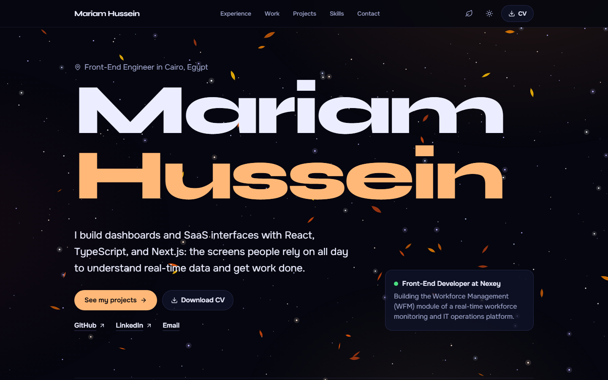

# Mariam Hussein — Portfolio

My personal portfolio site: who I am, the projects I've built, my experience, and how to reach me. Built with React, TypeScript, Vite, and Tailwind CSS.

**Live site:** [ _Mariam Hussein Portfolio_](https://mariamhussein.vercel.app/)



## Features

- Home page with Experience, Professional work, featured Projects, Skills, and Contact sections
- A separate Projects page at `/projects/` with every project in a three-column grid
- Project cards with screenshots, highlights, tech stack, and links to the live demo and source code
- Navigation that highlights the section you're reading
- Light and dark themes that follow the system setting, with a toggle that remembers your choice and no flash on load
- Downloadable CV and a one-click "Copy email" button
- Responsive from small phones to large screens, with the headline sized to fit any width
- Accessible: skip link, semantic landmarks, labelled links, visible focus, and reduced-motion support
- Social preview image and meta tags for sharing on LinkedIn and other sites
- Fonts bundled with the site and screenshots in WebP, so pages load fast

See [CHANGELOG.md](./CHANGELOG.md) for what has changed and when.

## Updating the content

All the text lives in one file, `src/data/profile.ts`: intro, about, projects, work, experience, skills, education, and links. Edit it and the page updates; no component changes are needed.

- **Projects:** the first three in the `projects` list are featured on the home page; the Projects page shows all of them.
- **Project links:** each project has a `demo` field. Leave it empty to hide the "Live demo" link, or paste the deployed URL to show it.
- **Screenshots:** replace the images in `public/projects/` with the same file names. 1600×1000 WebP or PNG works best.
- **CV:** replace `public/Mariam_Hussein_CV.pdf` with a newer version using the same file name.

## Getting started

You need [Node.js](https://nodejs.org/) 20.19 or newer.

```bash
git clone https://github.com/mariamhus/portfolio.git
cd portfolio
npm install
npm run dev
```

Then open http://localhost:5173.

| Command           | What it does                        |
| ----------------- | ----------------------------------- |
| `npm run dev`     | Starts the dev server               |
| `npm run build`   | Type-checks and builds to `dist/`   |
| `npm run preview` | Serves the production build locally |

## Project structure

```
public/
├── projects/              Project screenshots
├── Mariam_Hussein_CV.pdf
├── favicon.svg
└── og.png                 Image shown when the link is shared
src/
├── components/            One component per section, plus Header, Layout, ProjectCard, and shared pieces
├── data/profile.ts        All site content
├── hooks/
│   ├── useActiveSection.ts
│   └── useTheme.ts
├── App.tsx                Home page
├── ProjectsPage.tsx       Projects page (entry: projects.tsx, HTML: projects/index.html)
├── index.css              Theme colors, fonts, and shared styles
└── main.tsx
```

## Deploying

Import the repository at [vercel.com/new](https://vercel.com/new) and click **Deploy**. Vite is detected automatically.

The social preview tags (`og:image`, `og:url`, and the canonical link) need absolute URLs. On Vercel they're filled in automatically from your production domain. On another host, or with a custom domain, set the `SITE_URL` environment variable to the full address, for example `SITE_URL=https://mariamhussein.dev`.
